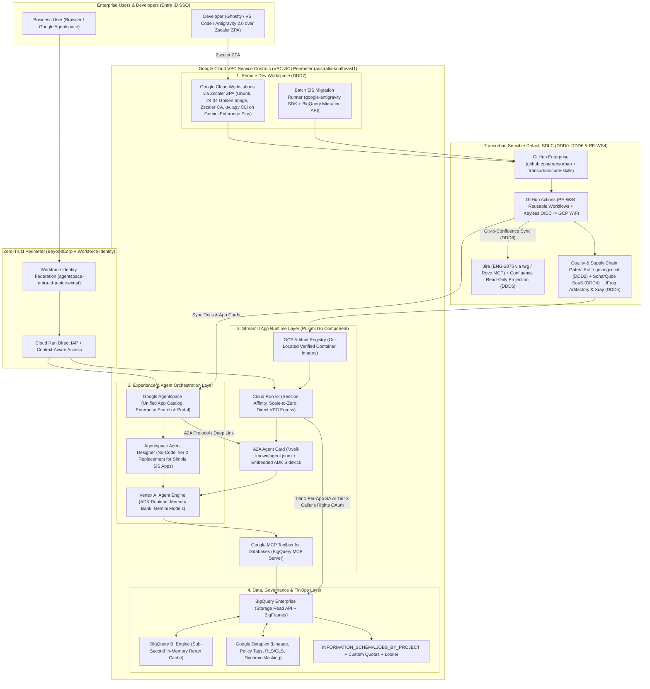

# ENG-2075: Google Cloud, Agentspace & Antigravity Reference Architecture (Aligned with Transurban Sensible Defaults)

> [!IMPORTANT]
> **Jira Sync Status — Updated Live on [ENG-2075](https://transurban.atlassian.net/browse/ENG-2075):**
> - **Epic Description Updated:** [ENG-2075](https://transurban.atlassian.net/browse/ENG-2075) (and local [epic.md](file:///Users/pwait/work/streamlit-bigquery/epic.md) + [google-garden-architecture.md](file:///Users/pwait/work/streamlit-bigquery/google-garden-architecture.md)) now reflects the **100% Google Cloud Runtime + Google Agentspace + Google Antigravity (on Gemini Enterprise Plus)** design paired with **Transurban's Sensible Default SDLC ([SEAL Development Design Decisions DDD0–DDD7](https://transurban.atlassian.net/wiki/spaces/SEAL/pages/40093876406/Development+Design+Decisions) & [PE-WS4](https://transurban.atlassian.net/wiki/spaces/CTS/pages/42531488146/PE-WS4+Blueprints+Golden+Path+Templates))**.
> - **Comment Added on `ENG-2075`:** Directly answered Jonathan Teow's question (*"What do we mean by 'app'????"*) using the **4-Tier SiS Disposition Taxonomy** (`Retire` → `Replace in Looker` → `Reimagine in Agentspace Agent Designer` → `Migrate to Cloud Run + BigQuery Streamlit`).

---

## 1. Executive Summary: Google Runtime & AI Garden + Transurban Sensible Defaults

Instead of replacing Transurban's established engineering toolchain with bespoke GCP DevOps tools (such as Secure Source Manager or Cloud Build), **Project GravityWell** draws a clean boundary:

1. **100% Google Cloud Runtime, Data & AI Plane (`australia-southeast1`):**
   - **Compute & Zero-Trust Edge:** **Cloud Run v2** (`sessionAffinity: true` for Streamlit WebSockets, `minInstanceCount: 0`) fronted by **Cloud Run Direct IAP** federated to **Microsoft Entra ID** via **Workforce Identity Federation** (`locations/global/workforcePools/agentspace-entra-id-p-oidc-exnat/...`).
   - **Data & Acceleration:** **BigQuery Enterprise Edition** co-located in `australia-southeast1`, accelerated by **BigQuery BI Engine**, **BigQuery Storage Read API** (Apache Arrow streaming), and **BigFrames**, governed by **Dataplex** Row-Level Security (RLS), Column-Level Security (CLS), and Dynamic Masking.
   - **Enterprise Discovery & No-Code Agent Tier:** **Google Agentspace (`gemini-us.transurban.com`)** acts as the unified catalog for all governed Streamlit apps, hosts **No-Code Agentspace Agents** (via **Agent Designer** + **Google MCP Toolbox for BigQuery**) to replace simple query/lookup SiS apps without containers, and powers an optional embedded **Vertex AI Agent Engine (ADK)** sidekick + **A2A Agent Card (`/.well-known/agent.json`)** inside complex Streamlit apps.
2. **Transurban Sensible Default Inner & Outer Loop ([DDD0–DDD7](https://transurban.atlassian.net/wiki/spaces/SEAL/pages/40093876406/Development+Design+Decisions) & [PE-WS4](https://transurban.atlassian.net/wiki/spaces/CTS/pages/42531488146/PE-WS4+Blueprints+Golden+Path+Templates)):**
   - **Inner Loop ([DDD0](https://transurban.atlassian.net/wiki/spaces/SEAL/pages/42567892996/DDD0+-+Developer+Inner+Loop+Strategy) & [DDD7](https://transurban.atlassian.net/wiki/spaces/SEAL/pages/42566713776/DDD7+-+Remote+Development+Workspace)):** **Google Cloud Workstations** behind **Zscaler Private Access (ZPA)** running the PE-WS4 Golden Ubuntu 24.04 container (pre-baked Zscaler Root CA, `uv`, Python 3.12+, Go, Pulumi, and **Google Antigravity `agy` 2.0 on Gemini Enterprise Plus**) + `transurban/mac-dev-bootstrap` on macOS.
   - **Portable Agent Harness ([Catalog](https://transurban.atlassian.net/wiki/spaces/SEAL/pages/42562814412/Transurban+AI+Coding+Agents+-+Plugin+Skill+Catalog)):** Migration and scaffolding skills (`sis-to-bq-migrator`, `sis-disposition-triager`, `bq-streamlit-scaffold`) are published into **[`transurban/code-skills`](https://github.com/transurban/code-skills)** alongside `AGENTS.md` (`CLAUDE.md` symlink + `.github/copilot-instructions.md`), working seamlessly across Antigravity, Claude Code, and GitHub Copilot.
   - **Outer Loop ([DDD1](https://transurban.atlassian.net/wiki/spaces/SEAL/pages/40090632665/DDD1+-+GitHub)–[DDD6](https://transurban.atlassian.net/wiki/spaces/SEAL/pages/42375610524/DDD6+-+Documentation+Philosophy)):** **GitHub Enterprise (`github.com/transurban`)**, **GitHub Actions** (keyless OIDC → GCP WIF), **Pulumi (Go)**, **Ruff & golangci-lint**, **Pair Programming**, **SonarQube SaaS (SonarCloud)** quality gates, **JFrog SaaS (`transurban.jfrog.io` Artifactory & Xray)**, **Jira (`twg` & Atlassian Rovo MCP)**, and **Docs-as-Code projected to Confluence & Agentspace**.

---

## 2. Answering "What Do We Mean by an 'App'?" (4-Tier SiS Disposition Taxonomy)

| Tier | Disposition | What Qualifies? | Target Destination |
| :--- | :--- | :--- | :--- |
| **Tier 0** | **Retire** | Unused, duplicate, or ad-hoc exploratory SiS scripts (`0` executions in 90 days). | Archive cleanly in GitHub ([DDD1](https://transurban.atlassian.net/wiki/spaces/SEAL/pages/40090632665/DDD1+-+GitHub)); decommission in Snowflake. |
| **Tier 1** | **Replace (BI Dashboard)** | Read-only KPI charts, standard filterable tables, scheduled reporting with no custom Python state or write-back. | **Looker / Looker Studio Pro** on **BigQuery BI Engine**. |
| **Tier 2** | **Reimagine (No-Code Data Agent)** | Simple parameterised SQL lookups, table Q&A, or lightweight data exploration where analysts wanted an "in-browser, zero-Git" experience. | **Google Agentspace Agent Designer** connected to BigQuery via **Google MCP Toolbox for Databases**. Zero repo or container to maintain. |
| **Tier 3** | **Migrate (Stateful Python Data App — *this platform*)** | **Custom interactive Python applications** requiring multi-step stateful workflows, operational write-backs/approvals, simulations, ML inference, complex `BigFrames`/Arrow transforms, or bespoke UI components + embedded ADK sidekick. | **Golden Path Streamlit App on Cloud Run v2 + Direct IAP + BigQuery**, deployed via `platform.NewStreamlitApp` (Pulumi Go) and registered in **Google Agentspace**. |

---

## 3. End-to-End Architecture Diagram

---

## 4. Transurban Sensible Default Alignment Matrix (`DDD0`–`DDD7`)

| Decision | Transurban Sensible Default | How `ENG-2075` Implements It |
| :--- | :--- | :--- |
| **[DDD0 — Developer Inner Loop](https://transurban.atlassian.net/wiki/spaces/SEAL/pages/42567892996/DDD0+-+Developer+Inner+Loop+Strategy)** | • **Google Antigravity (`agy` 2.0)** on **Gemini Enterprise Plus** (`gemini-us.transurban.com`) via WIF (`agentspace-entra-id-p-oidc-exnat`). • *Gemini Code Assist / `tu-geminicodeassist-p-1` deprecated.* • Portable `AGENTS.md` + [`transurban/code-skills`](https://github.com/transurban/code-skills). • Zero IT tickets; Zscaler CA baked in. • Measured by *Time to First Commit* (< 15 min) + DX Survey. | • Antigravity on Gemini Enterprise Plus is the standard agentic harness. • New skills (`sis-to-bq-migrator`, `sis-disposition-triager`, `bq-streamlit-scaffold`) are published to `transurban/code-skills` (working across Antigravity, Claude Code, and Copilot). • Enforces the [NAT Data Attestation Playbook](https://transurban.atlassian.net/wiki/spaces/SEAL/pages/42650468432/Playbook+Moving+to+Antigravity+on+Gemini+Enterprise+Plus+incl.+NAT+attestation) via `.agents/rules/nat-data-compliance.md` and pre-commit hooks blocking NAT data/extracts in repos. |
| **[DDD1 — GitHub](https://transurban.atlassian.net/wiki/spaces/SEAL/pages/40090632665/DDD1+-+GitHub)** | **GitHub Enterprise (`github.com/transurban`)** via `transurban/github-org-manager` + **GitHub Actions** ([PE-WS4](https://transurban.atlassian.net/wiki/spaces/CTS/pages/42531488146/PE-WS4+Blueprints+Golden+Path+Templates)). | • All platform (`transurban/streamlit-bigquery-platform`) and app repos live in GitHub. • Keyless GitHub Actions OIDC → GCP Workload Identity Federation runs `pulumi preview` on PR and `pulumi up` on merge to `main`. • Retired SiS repos are archived cleanly, never deleted. |
| **[DDD2 — Linting](https://transurban.atlassian.net/wiki/spaces/SEAL/pages/40109245590/DDD2+-+Linting)** | **`ruff`** (Python) & **`golangci-lint` / `go vet`** (Go) enforced in IDE, hooks, and CI. | • Enforced in IDE/Workstation, Antigravity `.agents/hooks.json` (`postEdit` auto-lint + `bq query --dry_run`), and required GitHub PR status checks. |
| **[DDD3 — Pair Programming](https://transurban.atlassian.net/wiki/spaces/SEAL/pages/40142308116/DDD3+-+Pair+Programming)** | Human-human and human-agent pairing for complex work. | • Applied to Story 4 (`StreamlitApp` Pulumi Go component), Story 10 (Security threat model), and Story 11 (Pilot SiS app migration), combining Platform + Data engineer pairing with Antigravity `/grill-me`, `/plan`, and `/teamwork-preview`. |
| **[DDD4 — SonarQube](https://transurban.atlassian.net/wiki/spaces/SEAL/pages/40476246070/DDD4+-+SonarQube)** | **SonarQube SaaS (SonarCloud)** mandatory PR quality gate. | • Enforced as a required GitHub PR status check on both the Pulumi Go platform repo and the Golden Path Streamlit app template (coverage, reliability, smells, security hotspots). |
| **[DDD5 — Artifactory](https://transurban.atlassian.net/wiki/spaces/SEAL/pages/40615706809/DDD5+-+Artifactory)** | **JFrog SaaS (`transurban.jfrog.io` — Artifactory & Xray)**. | • `uv` Python dependencies and Go modules resolve via `transurban.jfrog.io` virtual repos. • **JFrog Xray** scans packages and container images in CI before pushing verified runtime images to regional **GCP Artifact Registry** (co-located with Cloud Run). |
| **[DDD6 — Documentation Philosophy](https://transurban.atlassian.net/wiki/spaces/SEAL/pages/42375610524/DDD6+-+Documentation+Philosophy)** | • **Docs live next to code in GitHub**. • **Maintain Once, Present Everywhere** (Confluence / GitHub Pages / Agentspace are read-only projections). • **Altitude Traceability** (10 ft → 100,000 ft). | • ADRs (`docs/adr/`), runbooks, and `README.md` live in GitHub next to code and tests, and auto-sync to **Confluence (`SEAL`/`CTS`)** and **Google Agentspace** on merge to `main`. • Every doc declares **Owner**, **Freshness mechanism**, and **Presentation target**. |
| **[DDD7 — Remote Dev Workspace](https://transurban.atlassian.net/wiki/spaces/SEAL/pages/42566713776/DDD7+-+Remote+Development+Workspace)** | **Google Cloud Workstations** behind **Zscaler ZPA** using the PE-WS4 Golden Container (Ubuntu 24.04 LTS, pre-baked Zscaler CA, `uv`, `agy`). | • Developers connect via `ghostty -e ssh dev-box` or VS Code Remote-SSH over ZPA with native GCP Workload Identity (ADC) — **zero local SA keys, < 15 minutes Time to First Commit**. • Respects the **DDD7 §6.5 Ownership Boundary** (Inner loop & Golden Image: Phil Wait; VPC/ZPA/Landing Zone: CloudOps / Julien Bonastre). |

---

## 5. Linked Child Story Cards Under [ENG-2075](https://transurban.atlassian.net/browse/ENG-2075) (`ENG-2076` – `ENG-2088` — **58 Story Points Total**)

| # | Jira Card | Story & Size (Points) | Cum. Pts | Scope Summary (Google Cloud + Agentspace + Antigravity + Sensible Defaults) |
| :-: | :--- | :--- | :-: | :--- |
| **1** | **[ENG-2076](https://transurban.atlassian.net/browse/ENG-2076)** | **Spike: ADRs (`ADR-001`..`004`) — M (5 pts)** | **5** | Author `docs/adr/ADR-001..004` in GitHub (auto-projected to Confluence per DDD6): 100% GCP (`Cloud Run v2` in `australia-southeast1`), Direct IAP + Entra ID WIF (`agentspace-entra-id-p-oidc-exnat`), Dual-Tier BigQuery access (Tier 1 per-app SA default; Tier 2 Caller's Rights OAuth + Dataplex RLS/CLS), and Pulumi Go state backend. |
| **2** | **[ENG-2077](https://transurban.atlassian.net/browse/ENG-2077)** | **Pulumi (Go) Repo Bootstrap — S (3 pts)** | **8** | Provision `transurban/streamlit-bigquery-platform` via `github-org-manager` (DDD1), root `AGENTS.md` (DDD0), keyless GitHub Actions OIDC → GCP WIF (`pulumi preview` on PR, `pulumi up` on `main`), `golangci-lint` (DDD2), Pulumi Go mock tests, **SonarQube SaaS** gate (DDD4), and **JFrog Artifactory** Go proxy (DDD5). |
| **3** | **[ENG-2078](https://transurban.atlassian.net/browse/ENG-2078)** | **Shared GCP Resources & Workstations — M (5 pts)** | **13** | Regional GCP Artifact Registry (fed by JFrog Xray scans), Direct VPC Egress, **Google Cloud Workstations** over **Zscaler ZPA** with the PE-WS4 Golden Container (DDD7), **BigQuery BI Engine** reservation, **Google MCP Toolbox for BigQuery**, and GCP Billing budgets/alerts. |
| **4** | **[ENG-2079](https://transurban.atlassian.net/browse/ENG-2079)** | **`StreamlitApp` Pulumi Component (Go) — L (8 pts)** | **21** | Built via Pair Programming (DDD3). Provisions Cloud Run v2 (`sessionAffinity: true`), least-privilege SA (`jobUser`, `readSessionUser`, dataset `dataViewer`), Direct IAP bound to Entra `AccessGroups`, Cloud Monitoring alerts, and **Google Agentspace** + **A2A (`/.well-known/agent.json`)** registration. |
| **5** | **[ENG-2080](https://transurban.atlassian.net/browse/ENG-2080)** | **SSO & Verified Identity (`src/auth.py`) — M (5 pts)** | **26** | Cryptographic verification of `X-Goog-IAP-Jwt-Assertion` ES256 signature against Google's public JWK keys; `@require_group` decorator; opt-in Tier 2 end-user OAuth token pass-through for Dataplex RLS/CLS. |
| **6** | **[ENG-2081](https://transurban.atlassian.net/browse/ENG-2081)** | **Golden Path Template + `code-skills` — M (5 pts)** | **31** | `transurban/streamlit-bigquery-template` (`uv` via JFrog Artifactory, `ruff`, `pytest`, `AppTest`, hardened Dockerfile, `src/bq.py` with Storage Read API + `BigFrames` + byte caps + job labels, optional `src/agent_sidekick.py` ADK drawer) + publish `sis-to-bq-migrator`, `sis-disposition-triager`, and `bq-streamlit-scaffold` to `transurban/code-skills`. |
| **7** | **[ENG-2082](https://transurban.atlassian.net/browse/ENG-2082)** | **Reusable App CI/CD Pipeline — M (5 pts)** | **36** | PE-WS4 reusable GitHub Actions workflow: Ruff/Bandit/Pytest/`AppTest` + BigQuery `--dry_run` → **SonarQube SaaS** quality gate → container build & **JFrog Xray** scan → push to GCP Artifact Registry → keyless `pulumi up` → DDD6 Git-to-Confluence & Agentspace sync. |
| **8** | **[ENG-2083](https://transurban.atlassian.net/browse/ENG-2083)** | **BigQuery Cost Guardrails — S (3 pts)** | **39** | Three-layer FinOps defense: Antigravity `.agents/hooks.json` `bq query --dry_run` check at dev time, `maximum_bytes_billed` + `@st.cache_data` + **BI Engine** in `src/bq.py`, and project custom query quotas + `INFORMATION_SCHEMA.JOBS_BY_PROJECT` cost-by-app view in Looker/Agentspace. |
| **9** | **[ENG-2084](https://transurban.atlassian.net/browse/ENG-2084)** | **Observability & OpenTelemetry — S (3 pts)** | **42** | Structured JSON logging to Cloud Logging, OpenTelemetry trace spans (`streamlit.page_render` → `bigquery.query` → `vertex_ai.adk_turn`) to Cloud Trace per `transurban/code-skills` `opentelemetry` skill, and per-app uptime/error alerts. |
| **10** | **[ENG-2085](https://transurban.atlassian.net/browse/ENG-2085)** | **Security Review & NAT Guardrails — M (5 pts)** | **47** | Threat model (IAP spoofing, SA over-privilege, exfiltration, ADK prompt injection via **Model Armor**, supply chain via **JFrog Xray**/**SonarQube**, and **NAT Data Attestation** guardrails per DDD0), data-classification mapping, and Security sign-off. |
| **11** | **[ENG-2086](https://transurban.atlassian.net/browse/ENG-2086)** | **Pilot SiS App Migration — M (5 pts)** | **52** | Pair-programmed migration (DDD3) of one representative SiS app using **Google Antigravity** + `sis-to-bq-migrator` skill + **BigQuery Migration Service API** + `AppTest` parity verification; capture learnings via `/learn` back into `transurban/code-skills`. |
| **12** | **[ENG-2087](https://transurban.atlassian.net/browse/ENG-2087)** | **SiS Inventory & 4-Tier Backlog — S (3 pts)** | **55** | Automated audit of all SiS apps scored via `sis-disposition-triager` into **Retire**, **Replace (Looker)**, **Reimagine (Google Agentspace Agent Designer)**, or **Migrate (Cloud Run Streamlit)**; bulk-create and link Jira migration stories under `ENG-2075` via `twg`. |
| **13** | **[ENG-2088](https://transurban.atlassian.net/browse/ENG-2088)** | **Docs-as-Code, Onboarding & Support — S (3 pts)** | **58** | Author quickstart (*"< 15 min to first commit on Cloud Workstations; < 1 hr to deployed dev app"*), migration playbook, and runbook in GitHub (`docs/`) with DDD6 altitude traceability, auto-projected to Confluence and Google Agentspace; verify 2nd team self-service onboarding. |
| **Total** | **13 Stories** | **Epic Cumulative Total (`1L + 7M + 5S`) — XL (58 pts)** | **58** | **Phase 1 Foundations: 16 pts \| Phase 2 Core Platform: 21 pts \| Phase 3 Outer Loop & Security: 13 pts \| Phase 4 Prove & Scale: 8 pts** |
